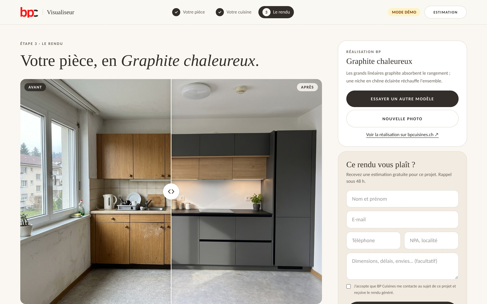

# Visualiseur de cuisines — BP Cuisines

Application web (mobile d'abord) : le client photographie sa pièce, choisit une cuisine du catalogue BP Cuisines et obtient en 30 à 60 secondes un rendu photoréaliste **jusqu'en 4K** de sa propre pièce équipée de ce modèle. Un comparateur avant/après, le téléchargement, le partage et une demande d'estimation (lead) complètent le parcours.



## Parcours

| Étape | Écran | Ce qui se passe |
|---|---|---|
| 1. Votre pièce | `StepPhoto` | Appareil photo natif (`capture="environment"`) ou import / glisser-déposer. Correction EXIF, réduction à 2560 px, contrôles qualité (résolution, portrait, luminosité). |
| 2. Votre cuisine | `StepModel` | 10 modèles (6 réalisations BP + 4 Arrex), filtres, nuanciers, options : implantation, ambiance jour/soir, sol, désencombrement. |
| 3. Le rendu | `StepRender` | Génération IA, progression, comparateur avant/après, plein écran au pixel près, téléchargement, partage, historique des essais, formulaire d'estimation. |

## Moteur de rendu

Le rendu utilise **Nano Banana Pro** (Google Gemini 3 Pro Image), le modèle qui conserve le mieux la géométrie d'une photo existante tout en reproduisant des matières à partir d'images de référence. Chaque rendu reçoit :

1. la photo du client (vérité géométrique : perspective, murs, fenêtres, sol, lumière) ;
2. 1 à 3 photos de la réalisation BP choisie (`public/catalogue/<id>/ref*.jpg`) ;
3. une fiche matière rédigée pour chaque modèle (`spec` dans `src/data/catalogue.ts`) ;
4. un prompt d'architecture-photo (`src/lib/prompt.ts`) qui impose de garder la pièce et de ne remplacer que la cuisine.

Trois fournisseurs interchangeables (`src/lib/ai/`) — un seul suffit :

| Variable | Fournisseur | Remarques |
|---|---|---|
| `KIE_API_KEY` | kie.ai | Recommandé : le moins cher, asynchrone, URLs de résultat hébergées. |
| `FAL_KEY` | fal.ai | File d'attente asynchrone, très fiable. |
| `GEMINI_API_KEY` | Google AI Studio | Appel direct Google, synchrone. Résultat renvoyé en base64 (prévoir un hébergement autre que Vercel Hobby, limite de réponse 4,5 Mo). |

Sans clé, l'application démarre en **mode démo** (rendu d'exemple pré-calculé) : pratique pour une présentation hors ligne.

## Installation

```bash
npm install
```

```bash
cp .env.example .env.local
```

```bash
npm run dev
```

L'application tourne sur http://localhost:3000.

## Catalogue

Les visuels sources (téléchargés depuis bpcuisines.ch) sont dans `assets/source/`. Pour ajouter un modèle :

1. déposer ses photos dans `assets/source/` ;
2. ajouter une entrée dans `src/data/catalogue.ts` (nom, textes, nuancier, `sources`, `refs`, `spec`) ;
3. régénérer les visuels optimisés :

```bash
npm run catalogue
```

Conseil : choisir comme références des vues frontales et larges, où façades, plan de travail et crédence sont bien visibles.

## Demandes d'estimation

`POST /api/lead` transmet chaque demande (coordonnées, modèle, options, lien du rendu) :
- à un webhook (`LEAD_WEBHOOK_URL` : Make, Zapier, n8n, Slack…) ;
- et/ou par e-mail via Resend (`RESEND_API_KEY`, `LEAD_EMAIL_TO`).

## Déploiement (Vercel recommandé)

1. Importer le dépôt dans Vercel.
2. Renseigner `KIE_API_KEY` (ou `FAL_KEY`), `RENDER_RESOLUTION=4K`, `NEXT_PUBLIC_SITE_URL`, et la destination des leads.
3. Brancher un sous-domaine, par exemple `visualiseur.bpcuisines.ch`, et ajouter un bouton « Visualiser chez moi » sur le site principal.

`maxDuration` de la route de rendu est fixé à 300 s (plan Pro conseillé si vous utilisez Gemini en synchrone).

## API

| Route | Méthode | Rôle |
|---|---|---|
| `/api/status` | GET | Moteur actif, mode démo, résolution. |
| `/api/render` | POST (multipart) | `photo`, `modelId`, `options` → `jobId`. Limite par IP et par jour (`RENDER_LIMIT_PER_DAY`). |
| `/api/render/:jobId` | GET | État du rendu (`pending` / `done` + `imageUrl` / `error`). |
| `/api/lead` | POST (JSON) | Demande d'estimation. |

## Captures du parcours

```bash
node scripts/screenshots.cjs http://localhost:3000 docs/screens
```

## Limites connues

- Le rendu est une **visualisation d'ambiance** : l'IA respecte la pièce mais pas des cotes au millimètre. Le relevé de mesures reste indispensable (mention affichée dans l'app).
- Le limiteur de débit est en mémoire (une instance). Pour plusieurs instances, brancher Upstash Redis.
- Les URLs de résultat kie.ai sont temporaires : pour conserver les rendus, ajouter un stockage (Vercel Blob, S3).
